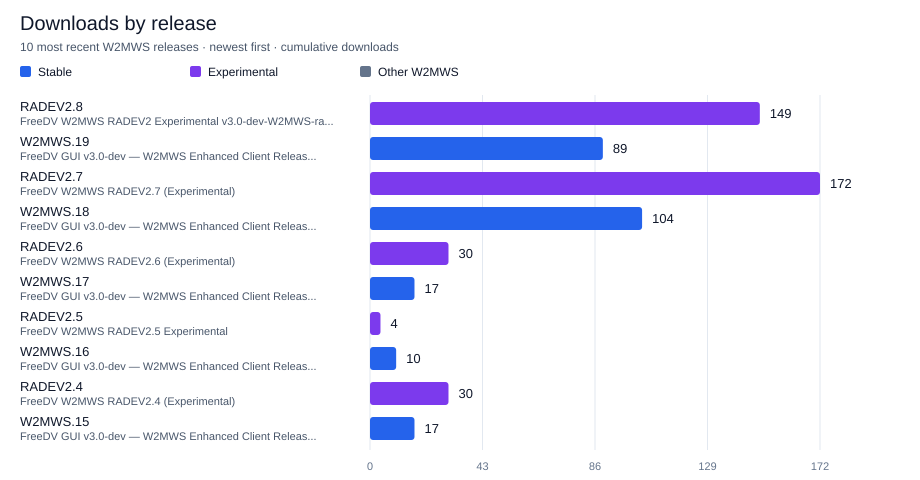
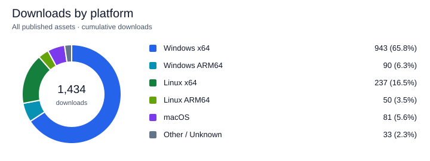
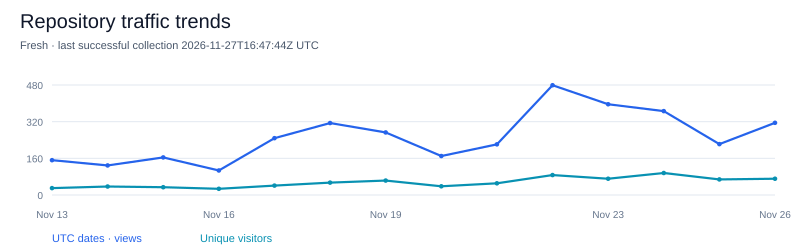

# GitHub Release Statistics

[msteele999/freedv-gui](https://github.com/msteele999/freedv-gui/releases) · downloads, engagement and repository traffic

**Most recent successful collection: 2026-11-25T17:23:03Z UTC.**

| Release downloads (cumulative) | Published releases | Stars |
| ---: | ---: | ---: |
| **1,357** | **29** | **2** |

| Subscribers / watchers | Forks | Unique visitors (14 days) |
| ---: | ---: | ---: |
| **0** | **0** | **324** |

Stable W2MWS: **529** · Experimental RADEV2: **828** · Other: **0** downloads.

Releases: Fresh · last successful collection 2026\-11\-25T17:23:03Z UTC. Engagement: Fresh · last successful collection 2026\-11\-25T17:23:03Z UTC. Traffic: Fresh · last successful collection 2026\-11\-25T17:23:03Z UTC.

## Downloads by release

Complete W2MWS release table

| Release | Name | Family | Published (UTC) | Downloads |
| --- | --- | --- | --- | ---: |
| [v3\.0\-dev\-W2MWS\-radev2\.10](https://github.com/msteele999/freedv-gui/releases/tag/v3.0-dev-W2MWS-radev2.10) | FreeDV W2MWS RADEV2 Experimental v3\.0\-dev\-W2MWS\-radev2\.10 | Experimental | 2026\-11\-23 | 170 |
| [v3\.0\-dev\-W2MWS\.20](https://github.com/msteele999/freedv-gui/releases/tag/v3.0-dev-W2MWS.20) | FreeDV GUI v3\.0\-dev — W2MWS Enhanced Client Release 20 | Stable | 2026\-11\-22 | 108 |
| [v3\.0\-dev\-W2MWS\-radev2\.9](https://github.com/msteele999/freedv-gui/releases/tag/v3.0-dev-W2MWS-radev2.9) | FreeDV W2MWS RADEV2 Experimental v3\.0\-dev\-W2MWS\-radev2\.9 | Experimental | 2026\-11\-21 | 144 |
| [v3\.0\-dev\-W2MWS\-radev2\.8](https://github.com/msteele999/freedv-gui/releases/tag/v3.0-dev-W2MWS-radev2.8) | FreeDV W2MWS RADEV2 Experimental v3\.0\-dev\-W2MWS\-radev2\.8 | Experimental | 2026\-11\-17 | 197 |
| [v3\.0\-dev\-W2MWS\.19](https://github.com/msteele999/freedv-gui/releases/tag/v3.0-dev-W2MWS.19) | FreeDV GUI v3\.0\-dev — W2MWS Enhanced Client Release 19 | Stable | 2026\-11\-17 | 117 |
| [v3\.0\-dev\-W2MWS\-radev2\.7](https://github.com/msteele999/freedv-gui/releases/tag/v3.0-dev-W2MWS-radev2.7) | FreeDV W2MWS RADEV2\.7 \(Experimental\) | Experimental | 2026\-11\-12 | 203 |
| [v3\.0\-dev\-W2MWS\.18](https://github.com/msteele999/freedv-gui/releases/tag/v3.0-dev-W2MWS.18) | FreeDV GUI v3\.0\-dev — W2MWS Enhanced Client Release 18 | Stable | 2026\-11\-12 | 108 |
| [v3\.0\-dev\-W2MWS\-radev2\.6](https://github.com/msteele999/freedv-gui/releases/tag/v3.0-dev-W2MWS-radev2.6) | FreeDV W2MWS RADEV2\.6 \(Experimental\) | Experimental | 2026\-11\-06 | 30 |
| [v3\.0\-dev\-W2MWS\.17](https://github.com/msteele999/freedv-gui/releases/tag/v3.0-dev-W2MWS.17) | FreeDV GUI v3\.0\-dev — W2MWS Enhanced Client Release 17 | Stable | 2026\-11\-06 | 18 |
| [v3\.0\-dev\-W2MWS\-radev2\.5](https://github.com/msteele999/freedv-gui/releases/tag/v3.0-dev-W2MWS-radev2.5) | FreeDV W2MWS RADEV2\.5 Experimental | Experimental | 2026\-11\-04 | 4 |
| [v3\.0\-dev\-W2MWS\.16](https://github.com/msteele999/freedv-gui/releases/tag/v3.0-dev-W2MWS.16) | FreeDV GUI v3\.0\-dev — W2MWS Enhanced Client Release 16 | Stable | 2026\-11\-04 | 10 |
| [v3\.0\-dev\-W2MWS\-radev2\.4](https://github.com/msteele999/freedv-gui/releases/tag/v3.0-dev-W2MWS-radev2.4) | FreeDV W2MWS RADEV2\.4 \(Experimental\) | Experimental | 2026\-11\-01 | 33 |
| [v3\.0\-dev\-W2MWS\.15](https://github.com/msteele999/freedv-gui/releases/tag/v3.0-dev-W2MWS.15) | FreeDV GUI v3\.0\-dev — W2MWS Enhanced Client Release 15 | Stable | 2026\-11\-01 | 17 |
| [v3\.0\-dev\-W2MWS\-radev2\.2](https://github.com/msteele999/freedv-gui/releases/tag/v3.0-dev-W2MWS-radev2.2) | FreeDV W2MWS RADEV2\.2 \- PI Timing Test | Experimental | 2026\-11\-01 | 33 |
| [v3\.0\-dev\-W2MWS\-radev2\.1](https://github.com/msteele999/freedv-gui/releases/tag/v3.0-dev-W2MWS-radev2.1) | FreeDV W2MWS RADEV2 Experimental 1 | Experimental | 2026\-10\-30 | 14 |
| [v3\.0\-dev\-W2MWS\.14](https://github.com/msteele999/freedv-gui/releases/tag/v3.0-dev-W2MWS.14) | FreeDV GUI v3\.0\-dev — W2MWS Enhanced Client Release 14 | Stable | 2026\-10\-29 | 17 |
| [v3\.0\-dev\-W2MWS\.13](https://github.com/msteele999/freedv-gui/releases/tag/v3.0-dev-W2MWS.13) | FreeDV GUI v3\.0\-dev — W2MWS Enhanced Client Release 13 | Stable | 2026\-10\-28 | 10 |
| [v3\.0\-dev\-W2MWS\.12](https://github.com/msteele999/freedv-gui/releases/tag/v3.0-dev-W2MWS.12) | FreeDV GUI v3\.0\-dev — W2MWS Enhanced Client Release 12 | Stable | 2026\-10\-27 | 11 |
| [v3\.0\-dev\-W2MWS\.11](https://github.com/msteele999/freedv-gui/releases/tag/v3.0-dev-W2MWS.11) | FreeDV GUI v3\.0\-dev — W2MWS Enhanced Client Release 11 | Stable | 2026\-10\-23 | 11 |
| [v3\.0\-dev\-W2MWS\.10](https://github.com/msteele999/freedv-gui/releases/tag/v3.0-dev-W2MWS.10) | FreeDV GUI v3\.0\-dev — W2MWS Enhanced Client Release 10 | Stable | 2026\-10\-22 | 6 |
| [v3\.0\-dev\-W2MWS\.9](https://github.com/msteele999/freedv-gui/releases/tag/v3.0-dev-W2MWS.9) | FreeDV GUI v3\.0\-dev — W2MWS Enhanced Client Release 9 | Stable | 2026\-10\-18 | 15 |
| [v3\.0\-dev\-W2MWS\.8](https://github.com/msteele999/freedv-gui/releases/tag/v3.0-dev-W2MWS.8) | FreeDV GUI v3\.0\-dev — W2MWS Enhanced Client Release 8 | Stable | 2026\-10\-14 | 12 |
| [v3\.0\-dev\-W2MWS\.7](https://github.com/msteele999/freedv-gui/releases/tag/v3.0-dev-W2MWS.7) | FreeDV GUI v3\.0\-dev — W2MWS Enhanced Client Release 7 | Stable | 2026\-10\-12 | 12 |
| [v3\.0\-dev\-W2MWS\.6](https://github.com/msteele999/freedv-gui/releases/tag/v3.0-dev-W2MWS.6) | FreeDV GUI v3\.0\-dev — W2MWS Enhanced Client Release 6 | Stable | 2026\-10\-09 | 9 |
| [v3\.0\-dev\-W2MWS\.5](https://github.com/msteele999/freedv-gui/releases/tag/v3.0-dev-W2MWS.5) | FreeDV GUI v3\.0\-dev — W2MWS Enhanced Client Release 5 | Stable | 2026\-10\-06 | 13 |
| [v3\.0\-dev\-W2MWS\.4](https://github.com/msteele999/freedv-gui/releases/tag/v3.0-dev-W2MWS.4) | FreeDV GUI v3\.0\-dev — W2MWS Enhanced Client Release 4 | Stable | 2026\-10\-03 | 10 |
| [v3\.0\-dev\-W2MWS\.3](https://github.com/msteele999/freedv-gui/releases/tag/v3.0-dev-W2MWS.3) | FreeDV GUI v3\.0\-dev — W2MWS Enhanced Client Release 3 | Stable | 2026\-10\-02 | 8 |
| [v3\.0\-dev\-W2MWS\.2](https://github.com/msteele999/freedv-gui/releases/tag/v3.0-dev-W2MWS.2) | FreeDV GUI v3\.0\-dev — W2MWS Enhanced Client Release 2 | Stable | 2026\-10\-02 | 10 |
| [v3\.0\-dev\-W2MWS\.1](https://github.com/msteele999/freedv-gui/releases/tag/v3.0-dev-W2MWS.1) | FreeDV GUI v3\.0\-dev — W2MWS Enhanced Client Release 1 | Stable | 2026\-10\-02 | 7 |

## Downloads by platform

Platform and asset-format breakdown

| Platform | Downloads | Share |
| --- | ---: | ---: |
| Windows x64 | 882 | 65.0% |
| Windows ARM64 | 83 | 6.1% |
| Linux x64 | 228 | 16.8% |
| Linux ARM64 | 50 | 3.7% |
| macOS | 81 | 6.0% |
| Other / Unknown | 33 | 2.4% |

| Asset format | Downloads |
| --- | ---: |
| Installers / distributions | 1,109 |
| ZIP archives | 248 |
| Other archives | 0 |
| Other files | 0 |

## Repository traffic

**Rolling 14-day window; these are repository visits and clones, not release downloads.**

Traffic snapshot: Fresh · last successful collection 2026\-11\-25T17:23:03Z UTC.

| Views | Unique visitors | Clones | Unique cloners |
| ---: | ---: | ---: | ---: |
| 3,265 | 324 | 794 | 98 |

## Top referrers

Top external referring websites in the traffic snapshot. Referrals do **not** establish where release downloads originated.

| Referrer | Views | Unique visitors |
| --- | ---: | ---: |
| ja4joe\.livedoor\.blog | 162 | 52 |
| jh3eca\.sakura\.ne\.jp | 102 | 25 |
| hamradio\.my | 90 | 40 |
| tonaru\.net | 74 | 13 |
| groups\.io | 61 | 25 |
| blog\.livedoor\.jp | 34 | 14 |
| reddit\.com | 33 | 22 |
| mail3\.spectrum\.net | 30 | 1 |
| qso\.freedv\.org | 20 | 14 |

GitHub self-referrals (excluded above)

| Referrer | Views | Unique visitors |
| --- | ---: | ---: |
| github\.com | 25 | 22 |

## Popular pages

Top repository pages in the same traffic snapshot.

| Repository page | Views | Unique visitors |
| --- | ---: | ---: |
| [/releases](https://github.com/msteele999/freedv-gui/releases) | 822 | 174 |
| [Overview](https://github.com/msteele999/freedv-gui) | 422 | 138 |
| [/releases/tag/v3\.0\-dev\-W2MWS\-radev2\.7](https://github.com/msteele999/freedv-gui/releases/tag/v3.0-dev-W2MWS-radev2.7) | 282 | 99 |
| [/actions](https://github.com/msteele999/freedv-gui/actions) | 214 | 14 |
| [/releases/tag/v3\.0\-dev\-W2MWS\-radev2\.8](https://github.com/msteele999/freedv-gui/releases/tag/v3.0-dev-W2MWS-radev2.8) | 207 | 80 |
| [/releases/tag/v3\.0\-dev\-W2MWS\-radev2\.9](https://github.com/msteele999/freedv-gui/releases/tag/v3.0-dev-W2MWS-radev2.9) | 199 | 80 |
| [/releases/tag/v3\.0\-dev\-W2MWS\.19](https://github.com/msteele999/freedv-gui/releases/tag/v3.0-dev-W2MWS.19) | 158 | 60 |
| [/releases/tag/v3\.0\-dev\-W2MWS\-radev2\.10](https://github.com/msteele999/freedv-gui/releases/tag/v3.0-dev-W2MWS-radev2.10) | 146 | 63 |
| [/releases/tag/v3\.0\-dev\-W2MWS\.20](https://github.com/msteele999/freedv-gui/releases/tag/v3.0-dev-W2MWS.20) | 123 | 38 |
| [/releases/tag/v3\.0\-dev\-W2MWS\.18](https://github.com/msteele999/freedv-gui/releases/tag/v3.0-dev-W2MWS.18) | 78 | 42 |

## Data notes

- Downloads are cumulative uploaded-asset counts, not unique users, installations or historical daily activity. Automatic GitHub source archives are excluded; manually uploaded assets remain included.
- Stable tags match v3.0-dev-W2MWS.N; experimental tags match v3.0-dev-W2MWS-radev2.N. ZIP bundles are kept distinct and are not directly comparable to per-platform installers. Overview/platform totals cover all published releases; the release chart shows only the latest ten W2MWS releases.
- Stars measure interest, subscribers are actual repository watchers, and forks are repository copies. Subscribers use subscribers_count, never watchers_count (which generally mirrors stars).
- GitHub traffic covers a rolling 14-day window. Window uniques come directly from GitHub and must not be calculated by summing daily uniques. Missing data is not zero; the current day may be incomplete and later revised.
- Traffic failures retain the last successful snapshot, marked stale with its original timestamp. Top lists are GitHub's limited results; after excluding self-referrals, fewer than ten external referrers may remain. Referrals do not attribute release downloads.
- Historical download observations remain append-only. Daily traffic rows are upserted by UTC date from real API observations; overlaps replace older observations, without inventing earlier history. Deleted/replaced assets or counter revisions can affect apparent changes.
- APIs are collected sequentially, not atomically. Each section displays its own successful collection time. An unavailable or stale section may coexist with fresh release statistics.

[Current JSON](docs/release-stats/latest.json) · [Download history](docs/release-stats/history.csv) · [Repository history](docs/release-stats/repository-history.csv) · [Daily traffic](docs/release-stats/traffic-daily.csv) · [Referrers JSON](docs/release-stats/referrers-latest.json) · [Popular pages JSON](docs/release-stats/popular-pages-latest.json)

Updated daily at 06:23 UTC or by manual workflow dispatch. Python 3 standard library only. GITHUB_TOKEN (or GH_TOKEN) reads releases/engagement; RELEASE_STATS_TOKEN reads traffic. Local collection: python scripts/release_stats.py.
